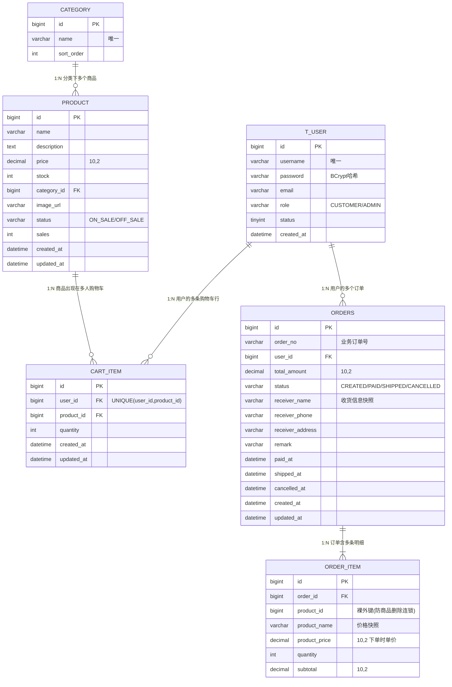

<!--
AI 辅助说明：本文件由 AI 辅助生成/修改
生成内容：数据库 ER 图（Mermaid 源码）+ 表关系说明
人工修改：无
审查状态：待人工审查
用途：课程报告素材。Mermaid 源码可直接贴入支持 Mermaid 的 Markdown 编辑器渲染，
     或到 https://mermaid.live 粘贴导出 PNG/SVG 图片插入报告
-->

# ShopSphere 数据库 ER 图

## 关键设计说明

1. **价格快照**：`order_item` 冗余存 `product_name` / `product_price` / `subtotal`，商品后续改价、下架不影响历史订单。
2. **裸外键**：`order_item.product_id` 是 `Long` 而非 `@ManyToOne` 关联——商品被删除时订单明细不受 JPA 级联影响。
3. **唯一约束**：`cart_item` 上 `UNIQUE(user_id, product_id)`，从数据库层保证同一用户同一商品只有一行（加购合并的依据）。
4. **收货快照**：`orders` 冗余存收件人信息，用户后续改资料不影响已下订单。
5. **订单状态机**：`CREATED → PAID → SHIPPED`；`CREATED / PAID → CANCELLED`（取消时回补库存）。
