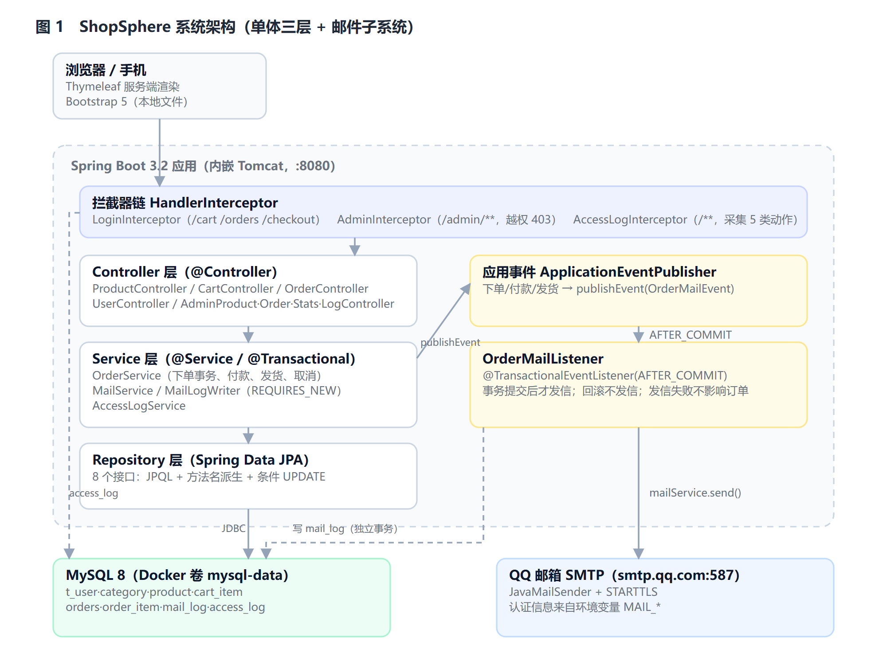
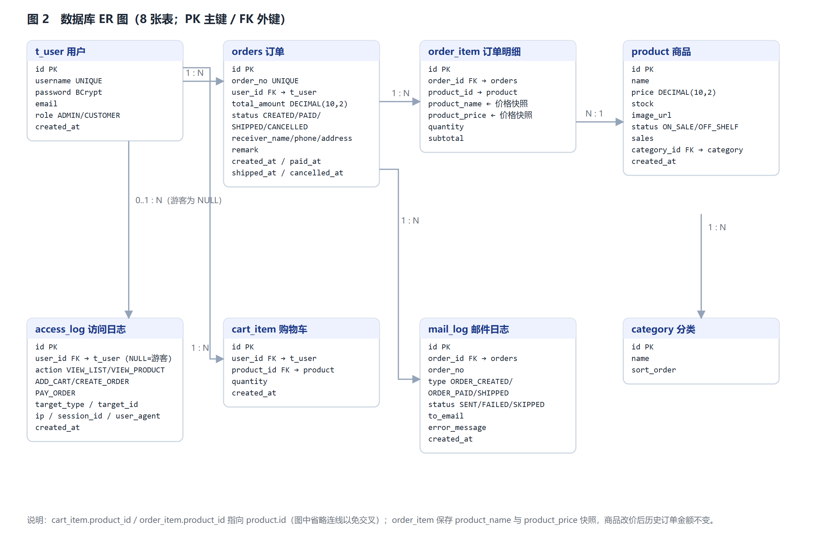
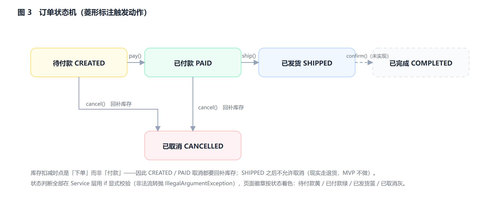
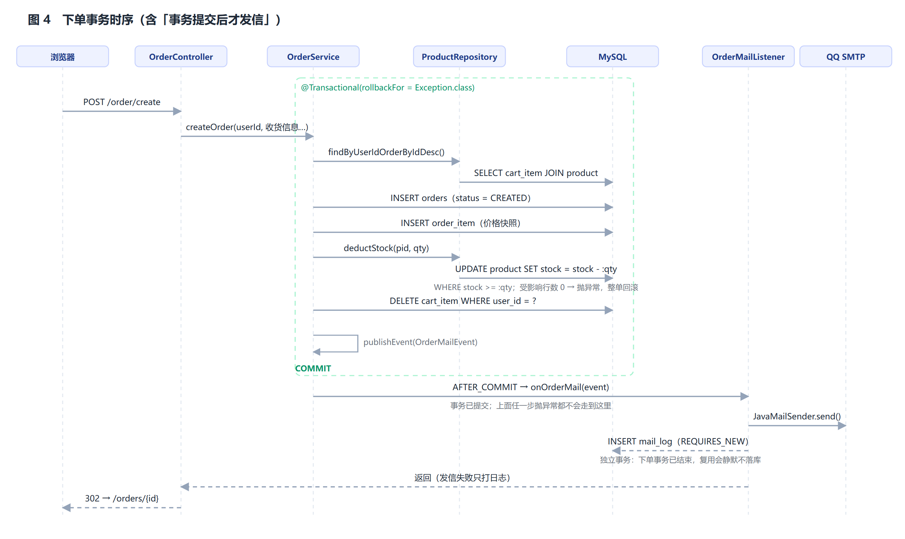

# 《网络应用架构设计与开发》实验报告

**题目**：ShopSphere 在线购物网站 —— 基于 Spring Boot 的单体电商系统设计与实现
**学号**：202430453150　**姓名**：周丹璐　**班级**：网络工程
**完成日期**：2026 年 11 月 15 日

| 交付项 | 地址 |
|---|---|
| 源码仓库（Public） | https://github.com/lala407/ShopSphere |
| 公网演示地址 | http://62.234.217.77:8080 |
| 演示账号 | 管理员 `admin / admin123`；普通用户 `demo / demo123` |

> 本报告正文与插图均在仓库内：正文 `docs/实验报告正文.md`、插图 `docs/diagrams/`、截图 `docs/screenshots/`、
> 逐条测试记录 `docs/测试记录.md`（45 条）。报告中的每个数字与结论都能在上述文件中找到对应证据。

---

## 1 实验目的与要求

课程要求独立完成一个「可部署上线的单体 Web 应用」，把课堂上分散讲授的知识点串成一条完整链路：
需求与用例 → 架构分层 → 数据库设计 → 接口与页面实现 → 事务与异常 → 部署上线 → 运维保障。

按实验指导书（`ex.html`，28 条要求）归并，本次需要交付的能力为六类：

| 类别 | 核心要求 | 本项目的落地方式 |
|---|---|---|
| 用户与权限 | 注册、登录、注销；区分普通用户与管理员；会话保持 | BCrypt 存储密码 + Session + `LoginInterceptor` / `AdminInterceptor` |
| 商品浏览 | 列表、分类、关键字搜索、分页、详情 | Thymeleaf 服务端渲染 + JPA `Page<Product>` + 条件 JPQL |
| 购物与下单 | 购物车增删改、下单、金额计算、库存校验 | 单一事务内完成「建单 → 写明细（价格快照）→ 条件扣库存 → 清购物车」 |
| 订单管理 | 订单状态与流转、后台发货/取消、订单历史 | 四态状态机（待付款/已付款/已发货/已取消），状态变更全部在 Service 层显式校验 |
| 后台管理 | 商品增删改查、订单管理、销售统计 | `/admin/**` 四个控制器：商品、订单、统计、日志 |
| 附加能力 | 邮件确认、浏览/购买日志、统计报表、可访问性 | 事务提交后发信 + `mail_log` 留痕；`access_log` 采集 5 类动作；`/healthz` 探活 |

此外，验收明确要求「部署后 3 个月内可访问」，因此运维层面的自愈与监控也计入交付，见第 7 章。

---

## 2 系统架构设计

### 2.1 总体架构



系统是**单体三层架构**：浏览器（含手机浏览器）通过 HTTP 访问内嵌 Tomcat 的 Spring Boot 应用，
请求依次穿过「拦截器链 → Controller → Service → Repository」四层，最终落到 MySQL 8；
业务之外还有一条**邮件子系统**（事件 → 监听器 → SMTP → 邮件日志）作为旁路。

各层职责与「为什么这么分」：

| 层 | 职责 | 设计理由 |
|---|---|---|
| 拦截器链 | 登录校验、管理员鉴权、访问日志采集 | 横切关注点，用 `HandlerInterceptor` 统一处理，避免在每个 Controller 里复制 `if (session == null)` |
| Controller | 解析参数、调用 Service、装配 Model、选择视图 | 只做「协议层」的翻译，不写业务判断，保证页面与接口共用同一套服务 |
| Service | 业务规则、事务边界、状态机校验 | `@Transactional` 落在这一层，一个业务动作 = 一个事务 |
| Repository | 数据访问（Spring Data JPA） | 简单查询用方法名派生，复杂查询用 `@Query` JPQL，条件更新用 `@Modifying` |
| 事件 + 监听器 | 订单邮件 | 把「发邮件」从下单事务中剥离，做到「事务提交后才发、发信失败不影响订单」 |

一次「下单」请求的完整链路可以对照图 4 阅读：`POST /order/create` → `OrderService.createOrder()`
（一个事务内 6 个步骤）→ 事务提交 → `AFTER_COMMIT` 事件 → 发信 + 写 `mail_log` → 302 跳转订单详情。

### 2.2 技术选型

| 技术 | 版本 | 选择理由 |
|---|---|---|
| Spring Boot | 3.2.5 | 内嵌 Tomcat，一个 jar 即一个服务；自动装配省掉大量 XML 配置 |
| Spring MVC + Thymeleaf | 6.1 / 3.1 | **服务端渲染**：无需前端构建链，模板即页面，答辩现场可直接看源码对应页面 |
| Spring Data JPA (Hibernate) | 6.4 | 实体即表结构，`Page`/`Pageable` 天然支持分页；`ddl-auto=update` 让开发期免手工建表 |
| MySQL | 8.0 | 课程要求的关系型数据库；`utf8mb4` 支持中文与 emoji；行锁保证库存扣减原子性 |
| Bootstrap | 5.3.3（**本地文件**） | 不依赖 CDN，断网/校园网限速也能正常渲染（见 2.3 第 4 条） |
| JavaMailSender | spring-boot-starter-mail | 标准 SMTP 客户端，QQ 邮箱 587 端口 + STARTTLS 即可发信 |
| Docker Compose | v2 | 一条命令拉起 app + mysql 两个容器，命名卷保证数据持久化 |

### 2.3 五个关键架构决策

1. **服务端渲染而不是前后端分离。**
   课程实验周期短、验收看「能不能跑通全链路」。Thymeleaf 让「Controller 返回 Model + 模板渲染」在一个进程内完成，
   省掉跨域、鉴权 token、前端构建三类问题；代价是页面交互不如 SPA 丰富，对本项目可以接受。

2. **单体而不是微服务。**
   功能边界只有「前台 / 后台」两块，拆分会引入服务发现、分布式事务等与课程目标无关的复杂度。
   单体的分层已经足够表达「架构设计」的能力，且部署成本最低（2 GB 内存的云服务器也能跑）。

3. **Session + 拦截器而不是 Spring Security。**
   引入 `spring-boot-starter-security` 会给全站套上默认登录墙，需要额外配置才能放行静态资源与登录页；
   本项目的权限模型只有「登录 / 管理员」两种，两个拦截器共 30 行代码即可表达清楚。
   BCrypt 单独引入 `spring-security-crypto` 使用（加密能力保留，过滤链不要）。已知代价：没有 CSRF 防护，
   作为「已知限制」写在 8.2。

4. **静态资源全部本地化。**
   早期版本 Bootstrap 走 `cdn.jsdelivr.net`、商品图走 `picsum.photos`。实测校园网访问 CDN 偶发超时，
   一旦失败整站变成无样式白页，截图也救不回来。现在 `bootstrap.min.css`（232 803 B）与 20 张商品图
   都放在 `src/main/resources/static/`，页面**零外链**：`grep -c "picsum\|jsdelivr"` 在渲染后的 HTML 中只剩注释文字。

5. **「发邮件」用应用事件解耦。**
   如果在下单方法里直接 `mailService.send(...)`，一旦后续步骤抛异常回滚，顾客会收到一封「下单成功」、
   库里却没有订单的邮件。改为发布 `OrderMailEvent` + `@TransactionalEventListener(AFTER_COMMIT)`，
   发信动作被推迟到事务提交之后（详见 5.5）。

---

## 3 数据库设计

### 3.1 ER 图



八张表分三组：

- **主数据**：`t_user`（用户）、`category`（分类）、`product`（商品）
- **交易**：`cart_item`（购物车）、`orders`（订单）、`order_item`（订单明细）
- **留痕**：`mail_log`（邮件发送记录）、`access_log`（浏览/购买行为日志）

### 3.2 表结构要点

| 表 | 关键字段 | 说明 |
|---|---|---|
| `t_user` | `username` 唯一、`password`(BCrypt)、`email`、`role` | 邮箱必填且做格式校验，因为它是订单通知的收件地址 |
| `product` | `price`、`stock`、`status`、`sales`、`category_id` | `status` 是软删除（`ON_SALE` / `OFF_SHELF`），下架不删数据，历史订单仍可查看 |
| `orders` | `order_no` 唯一、`total_amount`、`status`、`receiver_*`、四个时间戳 | `created_at / paid_at / shipped_at / cancelled_at` 分别对应状态流转节点 |
| `order_item` | `product_name`、`product_price`、`quantity`、`subtotal` | **价格快照**：下单时把商品名与单价抄一份，商品后续改价不影响历史订单金额 |
| `cart_item` | `user_id`、`product_id`、`quantity` | 同一商品重复加购时**合并数量**而不是插新行 |
| `mail_log` | `order_id`、`type`、`status`、`to_email`、`error_message` | 每封邮件一行，`status ∈ {SENT, FAILED, SKIPPED}` |
| `access_log` | `user_id`(可空)、`action`、`target_type/target_id`、`ip`、`session_id`、`user_agent` | 游客也能记（`user_id` 为 NULL），5 类动作见 5.6 |

### 3.3 三个值得说明的设计取舍

1. **为什么存价格快照？**
   `order_item.product_price` 与 `product.price` 是两份数据。若只存 `product_id`，商品一旦改价，
   历史订单金额会被「追溯修改」，对账和退款都会出错。快照让订单成为不可变事实。

2. **库存为什么在「下单」而不是「付款」时扣？**
   下单即占货，能防止「先下单不付款把库存锁死给别人」之外的超卖风险（反过来也会有人恶意占货，
   真实电商用超时释放解决，MVP 不做定时任务，故选择下单即扣、取消即回补，语义最直观）。

3. **`mail_log` 为什么不塞进 `orders`？**
   一个订单会发多封邮件（下单/付款/发货），且每封都可能失败重试。独立成表后，订单表只关心交易状态，
   邮件的「发没发、发给谁、为什么失败」有独立的事实记录，页面直接展示，不依赖登录邮箱去验证。

---

## 4 核心业务流程

### 4.1 订单状态机



四个可达状态加一条「未实现」的虚线：

| 流转 | 触发 | 校验 | 副作用 |
|---|---|---|---|
| — → `CREATED` | 用户提交订单 | 购物车非空、商品在售、库存足够 | 写订单 + 明细（价格快照）、条件扣库存、清购物车、发下单邮件 |
| `CREATED` → `PAID` | 用户点「模拟付款」 | 订单属于当前用户、状态为待付款 | 写 `paid_at`、发付款邮件 |
| `PAID` → `SHIPPED` | 管理员点「发货」 | 状态为已付款 | 写 `shipped_at`、发发货邮件 |
| `CREATED`/`PAID` → `CANCELLED` | 管理员点「取消」 | 状态为待付款或已付款 | 逐条回补库存、写 `cancelled_at` |
| `SHIPPED` → `COMPLETED` | —— | —— | **未实现**（见 8.2 第 3 条） |

状态判断全部写成显式 `if`，非法流转直接抛 `IllegalArgumentException`，由全局异常处理器转成友好错误页，
不依赖数据库枚举约束去「挡」——约束只能挡值，挡不住「从已发货回到待付款」这种语义错误。

### 4.2 下单事务时序



事务边界（绿色虚线框）覆盖 6 个步骤：**校验 → 建单 → 写明细 → 扣库存 → 清购物车 → 发布事件**。
任何一步抛异常，前面的 `INSERT` 全部回滚；事件发布本身不产生数据库写入，真正的发信在 `COMMIT` 之后。

这条时序线解释了三个容易被问到的点：

- 为什么扣库存要判断「受影响行数」而不是先查再改？见 5.2。
- 为什么事件要在事务内发布、监听在事务外执行？见 5.5。
- 为什么 `COMMIT` 之后还要写 `mail_log` 却不能用同一个事务？见 5.5 的 `REQUIRES_NEW`。

### 4.3 事务失效的三个坑（实测踩过）

| 坑 | 现象 | 规避方式 |
|---|---|---|
| 同类内部调用 `this.helper()` | 被调方法上的 `@Transactional` 不生效 | 下单相关写操作全部收进 `createOrder` 一个方法 |
| 默认只回滚 `RuntimeException` | 受检异常不回滚，出现「一半成功」 | `@Transactional(rollbackFor = Exception.class)` |
| `AFTER_COMMIT` 里 `repository.save()` | **不报错、不落库**，日志静默丢失 | 抽 `MailLogWriter`，用 `REQUIRES_NEW` 开独立事务（见 5.5） |

第三条是本项目最隐蔽的一个 bug：邮件明明发出去了，`mail_log` 里却一条记录都没有，
页面显示「未发送」。原因是 `AFTER_COMMIT` 阶段原事务已提交结束，`save()` 只是把对象放进持久化上下文，
没有新事务去提交它。**如果不写集成测试去断言 `mail_log` 行数，这个问题根本发现不了。**

---

## 5 核心代码实现

### 5.1 下单主流程：一个事务内的六个步骤

```java
// OrderService.java（节选，注释为报告补充）
@Transactional(rollbackFor = Exception.class)
public Order createOrder(Long userId, String receiverName, String receiverPhone,
                         String receiverAddress, String remark) {

    // ① 收货信息校验：前端 required 可以被绕过，后端必须再校验一遍
    if (receiverPhone == null || !receiverPhone.matches("^1\\d{10}$")) {
        throw new IllegalArgumentException("手机号格式不正确");
    }

    // ② 读购物车 + 算总价（顺带校验商品仍在售）
    List<CartItem> cartItems = cartItemRepository.findByUserIdOrderByIdDesc(userId);
    if (cartItems.isEmpty()) throw new IllegalArgumentException("购物车为空，无法下单");
    BigDecimal total = BigDecimal.ZERO;
    for (CartItem ci : cartItems) {
        Product p = ci.getProduct();
        if (p.getStatus() != ProductStatus.ON_SALE) {
            throw new IllegalArgumentException("商品「" + p.getName() + "」已下架");
        }
        total = total.add(p.getPrice().multiply(BigDecimal.valueOf(ci.getQuantity())));
    }

    // ③ 建单（金额在下单时固化）
    Order order = new Order();
    order.setOrderNo(generateOrderNo());
    order.setUser(user);
    order.setTotalAmount(total);
    order.setStatus(OrderStatus.CREATED);
    orderRepository.save(order);

    // ④ 写明细：价格快照 + 拼邮件摘要
    for (CartItem ci : cartItems) {
        Product p = ci.getProduct();
        OrderItem item = new OrderItem();
        item.setOrder(order);
        item.setProductId(p.getId());
        item.setProductName(p.getName());
        item.setProductPrice(p.getPrice());
        item.setQuantity(ci.getQuantity());
        item.setSubtotal(p.getPrice().multiply(BigDecimal.valueOf(ci.getQuantity())));
        orderItemRepository.save(item);
    }

    // ⑤ 条件扣库存：受影响行数为 0 说明库存不足 → 抛异常整单回滚
    for (CartItem ci : cartItems) {
        int affected = productRepository.deductStock(ci.getProduct().getId(), ci.getQuantity());
        if (affected == 0) {
            throw new IllegalArgumentException("商品「" + ci.getProduct().getName() + "」库存不足");
        }
    }

    // ⑥ 清空购物车 + 发布「下单成功」事件（真正发信在事务提交后）
    cartItemRepository.deleteByUserId(userId);
    eventPublisher.publishEvent(new OrderMailEvent(order.getId(), order.getOrderNo(),
            userEmail, receiverName, total, summary.toString(),
            MailType.ORDER_CREATED, LocalDateTime.now()));
    return order;
}
```

三点说明：

- **金额用 `BigDecimal` 而不是 `double`。** 货币是精确值，`0.1 + 0.2` 用 double 会得到 `0.30000000000000004`，
  订单金额累加多次后会出现「差一分钱」。
- **校验顺序有讲究。** 先校验收货信息（最便宜的判断），再读库算价，再写库；越早失败，回滚成本越低。
- **清购物车放在最后。** 如果前面库存不足抛异常，购物车内容原样保留，用户可以改数量重试。

### 5.2 条件扣库存：为什么不用「先查再改」

```java
// ProductRepository.java
@Modifying(flushAutomatically = true, clearAutomatically = true)
@Query("""
        UPDATE Product p
           SET p.stock = p.stock - :qty
         WHERE p.id = :pid
           AND p.stock >= :qty
        """)
int deductStock(@Param("pid") Long productId, @Param("qty") int quantity);
```

如果用「`findById` 查库存 → 判断 `stock >= qty` → `setStock(stock - qty)`」的写法，
两个并发请求可能同时读到 `stock = 1`、都判断「够」，然后各自减 1，最终库存变成 `-1`，也就是**超卖**。

把「判断」和「扣减」合并进同一条 `UPDATE`，由数据库的行锁保证原子性：只有 `stock >= qty` 时才会更新成功，
否则**受影响行数为 0**。调用方只需判断返回值：

```java
int affected = productRepository.deductStock(pid, qty);
if (affected == 0) throw new IllegalArgumentException("库存不足");   // 触发整单回滚
```

两个注解属性缺一不可：

- `flushAutomatically = true`：执行 `UPDATE` 前先把待写入的 `INSERT` 刷进数据库。否则 JPA 可能先扣库存、
  后写订单，一旦出错会出现「库存扣了、订单没落库」。
- `clearAutomatically = true`：`@Modifying` 绕过了一级缓存，执行后必须清空持久化上下文，
  否则后续读到的还是旧 `stock`。**副作用**：`order` 实体变成脱管状态，所以 `cancel()` 里回补库存后
  必须显式 `orderRepository.save(order)`，靠脏检查自动更新会失效。

### 5.3 多条件 + 分页查询

```java
// ProductRepository.java —— 一条 JPQL 同时表达「在售 + 分类 + 关键字」
@Query("""
        SELECT p FROM Product p
        WHERE p.status = com.shopsphere.common.ProductStatus.ON_SALE
          AND (:cid IS NULL OR p.categoryId = :cid)
          AND (:kw  IS NULL OR p.name LIKE CONCAT('%', :kw, '%'))
        """)
Page<Product> searchOnSale(@Param("cid") Long cid, @Param("kw") String kw, Pageable pageable);
```

```java
// ProductController.java —— 页码 0 基，每页 8 条，按 id 倒序
Pageable pageable = PageRequest.of(page, 8, Sort.by("id").descending());
Page<Product> pageData = productRepository.searchOnSale(cid, kw, pageable);
```

- `:cid IS NULL OR ...` 是**动态条件的 JPQL 写法**：参数为 null 时该条件恒真，等价于「不过滤」。
  这样一条语句覆盖四种组合（全部分类/指定分类 × 有/无关键字），不必写四个方法或用字符串拼 SQL。
- 返回值是 `Page` 而不是 `List`：分页条需要的 `totalPages`、`number`、`first`、`last` 全在里面，
  模板里直接 `${pageData.totalPages}`，不用自己去算总数。
- JPQL 里比较枚举必须写全限定名，写字符串会在启动时解析失败——这个坑在第一次跑测试时就暴露了。

### 5.4 统计报表：聚合与 Top5

```java
// OrderRepository.java
@Query("SELECT COALESCE(SUM(o.totalAmount), 0) FROM Order o WHERE o.status IN :statuses")
BigDecimal sumTotalAmountByStatusIn(@Param("statuses") Collection<OrderStatus> statuses);
```

```java
// OrderItemRepository.java —— 接口投影 + Pageable 当 LIMIT
@Query("""
        SELECT oi.productId     AS productId,
               oi.productName   AS productName,
               SUM(oi.quantity) AS totalQty
          FROM OrderItem oi
          JOIN oi.order o
         WHERE o.status IN :statuses
         GROUP BY oi.productId, oi.productName
         ORDER BY SUM(oi.quantity) DESC
        """)
List<HotProductStat> findHotProducts(@Param("statuses") Collection<OrderStatus> statuses,
                                     Pageable pageable);
```

- `COALESCE(SUM(...), 0)`：一张订单都没有时 `SUM` 返回 `null`，页面会显示空白或抛空指针，兜底成 0。
- 统计口径统一为 `PAID_STATUSES`（已付款 + 已发货），待付款没成交、已取消要剔除，
  否则「总销售额」会把取消的订单也算进去，和「热销 Top5」口径打架。
- **接口投影**：`HotProductStat` 只声明 `getProductId()/getProductName()/getTotalQty()`，
  JPQL 的列别名与 getter 一一对应即可，不需要建 DTO 类、也不需要写构造器。
- JPQL 没有 `LIMIT`，Top5 是靠 `PageRequest.of(0, 5)` 实现的。

### 5.5 事务提交后才发信（本项目最有价值的一段）

```java
// OrderMailListener.java
@TransactionalEventListener(phase = TransactionPhase.AFTER_COMMIT, fallbackExecution = true)
public void onOrderMail(OrderMailEvent event) {
    try {
        mailService.send(event);
    } catch (Exception e) {
        // 订单已经提交成功，不能因为发信失败给用户返回 500
        log.error("[邮件] 监听器异常兜底：订单 {} 的{}未处理",
                event.orderNo(), event.type().getLabel(), e);
    }
}
```

```java
// MailLogWriter.java —— 独立事务写日志，解决「发信成功但日志丢失」
@Transactional(propagation = Propagation.REQUIRES_NEW)
public void write(MailLog record) {
    mailLogRepository.save(record);
}
```

为什么这四行 `REQUIRES_NEW` 是必要的：

1. `AFTER_COMMIT` 执行时，下单事务**已提交并结束**，但当前线程仍绑着上一轮的 `EntityManager`；
2. 此时直接 `mailLogRepository.save(...)` **不报错也不落库**——`save` 只是 `persist` 到持久化上下文，
   没有新事务去提交它；
3. 把写入放进 `REQUIRES_NEW` 的方法里，Spring 挂起外层上下文、真开一个新事务，写完立刻提交，日志才稳定落库；
4. 不把整个 `MailService.send()` 标成 `REQUIRES_NEW`，是因为 SMTP 网络往返最长 5 秒，
   会让数据库连接被占住 5 秒。**发信走网络、写日志走短事务，两者分开。**

失败降级也在这条链路上：没配 `MAIL_USERNAME` 时 `MailService` 把记录写成 `SKIPPED`
（页面显示「未发送 —— 未配置发件账号」），授权码错误时写成 `FAILED` 并保存 `error_message`，
**两种情况下订单都照常创建**。这条降级路径是真机演练过的（曾出现 5 条 `SKIPPED` 且订单正常）。

### 5.6 访问日志：一个拦截器采集 5 类动作

```java
// AccessLogInterceptor.java
@Override
public void afterCompletion(HttpServletRequest request, HttpServletResponse response,
                            Object handler, Exception ex) {
    try {
        AccessAction action = resolveAction(request);   // 白名单：不在 5 类动作内返回 null
        if (action == null) return;
        accessLogService.record(action, targetTypeOf(action), targetIdOf(request, action), request);
    } catch (Exception e) {
        // 写日志失败绝不影响主流程
    }
}
```

```java
private AccessAction resolveAction(HttpServletRequest request) {
    String uri = request.getRequestURI();
    if ("GET".equals(request.getMethod())) {
        if ("/".equals(uri)) return AccessAction.VIEW_LIST;
        if (PRODUCT_DETAIL.matcher(uri).matches()) return AccessAction.VIEW_PRODUCT;
    }
    if ("POST".equals(request.getMethod())) {
        if ("/cart/add".equals(uri)) return AccessAction.ADD_CART;
        if ("/order/create".equals(uri)) return AccessAction.CREATE_ORDER;
        if (ORDER_PAY.matcher(uri).matches()) return AccessAction.PAY_ORDER;
    }
    return null;
}
```

四个设计点：

- 用 `afterCompletion` 而不是 `preHandle`：此时请求已经处理完，日志不会因为后续异常而漏记；
- **白名单而非黑名单**：只记 5 类业务动作，静态资源、`/login`、`/healthz` 通通不记，日志表不会被噪声灌满；
- 整个方法包 `try-catch`：日志是旁路能力，不能因为日志表满/连接超时把用户的请求打挂；
- 目标 ID 用正则从 URL 提取（`/orders/8/pay` → `8`），并在 `WebConfig` 里把 `/healthz` 排除，
  避免定时探活每 30 分钟写一条垃圾记录。

### 5.7 越权防护：两个拦截器

```java
// LoginInterceptor：只判断「有没有登录」
Object userId = request.getSession().getAttribute("userId");
if (userId != null) return true;
response.sendRedirect("/login");
return false;
```

```java
// AdminInterceptor：先判断登录，再判断角色；普通用户访问后台返回 403 而不是跳登录
if (session.getAttribute("userId") == null) { response.sendRedirect("/login"); return false; }
if (!UserRole.ADMIN.equals(session.getAttribute("role"))) {
    response.sendError(HttpServletResponse.SC_FORBIDDEN);
    return false;
}
```

前台所有「我的订单」操作还有第二道防线：`findByIdAndUserId(orderId, userId)` 用一条 SQL 同时完成
「存在 + 归属」判断，即使用户手改 URL 猜别人的订单 ID，也只会得到「订单不存在」。

---

## 6 功能测试

完整的 45 条测试记录见 `docs/测试记录.md`（含测试步骤、预期、实测结果与截图编号）。摘要如下：

| 分类 | 条数 | 代表性用例 |
|---|---|---|
| 用户与权限 | 8 | 注册查重、邮箱格式校验、登录失败提示、未登录跳转、普通用户访问后台 403 |
| 商品浏览 | 7 | 分类筛选、关键字搜索、分页、下架商品不出现在列表、详情页价格库存 |
| 购物车与下单 | 10 | 重复加购合并、数量改小、库存不足整单回滚（订单不落库、库存不变）、金额精度 |
| 订单管理 | 6 | 付款状态流转、重复付款拦截、后台发货、取消回补库存、订单归属校验 |
| 邮件通知 | 7 | 下单/付款/发货三封真机 SENT、`mail_log` 行数与状态、未配 SMTP 降级 SKIPPED、授权码错误降级 FAILED |
| 日志 | 5 | 5 类动作采集、游客记录 `user_id` 为 NULL、`/login` 不落日志、写日志失败不影响主流程 |
| 部署与可用性 | 7 | 公网各页 200、受保护页 302、数据卷持久化、种子数据、静态资源本地化、`/healthz` 探活、云端定时探活成功 |

几个关键实测结果：

| 测试点 | 证据 |
|---|---|
| 邮件真实投递 | 订单 `ORD202611152124149719` 在 `mail_log` 留下 3 条 `SENT`（下单/付款/发货），页面显示「已发送至 3101362993@qq.com」并带时间（截图 19、21） |
| 降级不影响主流程 | 未配 `MAIL_USERNAME` 期间 5 条记录为 `SKIPPED`，订单照常创建、页面提示「未配置发件账号」 |
| 库存不足回滚 | 8 个集成测试用 H2 内存库跑全链路，`mvn test` 全绿；手工把库存改为 1 后下单 2 件，订单表无新行、库存仍为 1 |
| 公网可用 | `/` `/login` `/register` `/product/20` `/healthz` 均 200；`/cart` `/admin/product` 未登录 302；`demo`、`admin` 均可登录（截图 18） |
| 自动化回归 | `AccessLogFlowTest`(4) + `MailServiceTest`(2) + `OrderMailFlowTest`(2) = 8 个用例 |

---

## 7 部署与运维

### 7.1 部署方式

```bash
git clone https://github.com/lala407/ShopSphere.git && cd ShopSphere
cp .env.example .env          # 填 DB_PASSWORD / MAIL_USERNAME / MAIL_PASSWORD
docker compose up -d --build  # 拉起 app + mysql 两个容器
docker compose logs -f app    # 看到 Started ShopSphereApplication 即成功
```

`docker-compose.yml` 里的三个关键设置：

- `depends_on: condition: service_healthy`：等 MySQL 健康检查通过再启动 app，避免「启动比数据库快」导致连不上；
- `restart: unless-stopped`：容器崩溃或服务器重启后自动拉起；
- 命名卷 `mysql-data`：`docker compose down` 后再 `up`，订单与用户数据都还在（测试记录第 23 条实测）。

静态资源与镜像无关，随 jar 打进容器；`-Xmx256m` 限制 JVM 堆，适配 2 GB 内存的云服务器。

### 7.2 3 个月可访问的三层保障

| 层次 | 手段 |
|---|---|
| 进程自愈 | `restart: unless-stopped`，异常退出自动重启 |
| 故障可发现 | `GET /healthz`：内部执行 `SELECT 1`，应用或 MySQL 任一不可用返回 503；实测 `200 UP db=2ms` |
| 云端监控 | GitHub Actions `uptime-check` 每 30 分钟 curl 一次公网 `/healthz`，失败重试 3 次后工作流红灯并邮件通知（首次运行 `conclusion: success`） |

`/healthz` 特意做成「查一次数据库」而不是「返回字符串」，因为很多故障是 MySQL 被 OOM 杀掉、
应用还在硬撑，此时首页会 500、但端口仍然开着——只探端口是探不出来的。

---

## 8 已知限制与改进方向

### 8.1 已实现的能力边界

- 付款是「模拟付款」，没有接真实支付渠道；
- 邮件是单向通知（下单/付款/发货），不做退订、模板管理；
- 后台统计是 4 个指标 + 热销 Top5，没有时间维度趋势图。

### 8.2 明确未做、且知道怎么做的项

| 项 | 现状 | 改进方案 |
|---|---|---|
| 无 CSRF 防护 | Session 鉴权，表单无 token | 引入 Spring Security 或自研一次性 token 校验 |
| 生产配置未分离 | `ddl-auto=update`、`show-sql=true` | 加 `application-prod.yml`（`validate`、关 SQL 日志）+ `SPRING_PROFILES_ACTIVE=prod` |

这些项在 `docs/需求对照与改进清单.md` 里编号为 P1-8 ~ P2-11，逐条写了位置与修复思路，属于「时间不够而非不知道」的范围。
（P1-1「下架商品详情未判状态」已在交付阶段修复：`detail()` 对非在售商品直接返回 404，
与前台列表口径一致，并新增 3 个集成测试覆盖，见 `docs/测试记录.md` 第 48 条。
P1-2「销量不累加」同批修复：付款成功时累加、已付款订单取消时对称回退，
前台「已售」与统计页热销 Top5 统一为「已付款成交量」口径，
见 `ProductRepository.incrementSales/decrementSales` 与测试记录第 49 条。
P1-3「状态机不闭环」同批修复：新增确认收货（SHIPPED→COMPLETED，`completed_at` 落值）
与用户取消待付款订单（回补库存），`CREATED→PAID→SHIPPED→COMPLETED` 全链路可演示，
见 `OrderLifecycleTest` 4 用例与测试记录第 50 条。
P1-4「订单详情无时间线」同批修复：详情页新增横向步骤条（下单→付款→发货→完成，
按各时间字段判定到达）与付款/发货/完成/取消时间明细，
见测试记录第 51 条。
P1-5「结算页表单缺 label」同批修复：收货人/手机号/收货地址/订单备注四个字段补齐
`<label for>` 与控件 `id` 关联、必填标红星、补 placeholder 与 autocomplete，
手机号改为 `type="tel"`，见测试记录第 55 条。
P1-6「后台订单无分页」同批修复：列表改为多条件分页查询（状态 / 关键字 /
下单日期区间三组条件，一条 JPQL 用 `(:param IS NULL OR ...)` 覆盖 16 种组合），
每页 10 条、按 `createdAt desc, id desc` 排序，翻页链接带回筛选条件，
见 `OrderRepository.search` 与测试记录第 56 条。
P1-7「后台无删除商品」同批修复：新增 `POST /admin/product/{id}/delete`——
先查 `order_item` 是否引用，无引用物理删除（顺带清理购物车引用）并提示成功，
有订单引用则拒绝删除并提示改用下架，保护历史订单与统计口径；
见 `AdminProductController.delete()` 与测试记录第 57 条。）

---

## 9 AI 辅助说明（学术诚信）

按课程要求如实说明 AI 参与范围。项目内每个源文件头部都有标注块，写明「AI 生成内容 / 人工修改 / 审查状态」，
Git 提交信息用 `AI辅助：` 与 `手写：` 前缀区分，可用 `git log` 逐条核对。

| 环节 | 参与方式 |
|---|---|
| 需求梳理与改进清单 | AI 对照 `ex.html` 生成 28 条要求的核查表，本人确认优先级 |
| 架构与数据库设计 | AI 给出分层方案与 8 张表的 DDL，本人确认字段与关系 |
| 邮件通知、访问日志、探活 | AI 实现，本人配置 SMTP 授权码、执行真机验证、确认降级行为 |
| 页面模板 | AI 生成骨架，本人调整文案与布局；注释块标注「骨架 / 手写」边界 |
| 测试 | AI 写集成测试与测试记录表，本人在真实 MySQL + QQ 邮箱环境复测并补充实测数据 |
| 本报告 | AI 起草，数据与结论均来自本仓库的测试记录与截图 |

**三个 AI 出错、由实测发现的例子**（保留在代码注释里）：

1. `AFTER_COMMIT` 里直接 `save()` 日志**静默丢失** → 引入 `REQUIRES_NEW`（5.5）；
2. Thymeleaf 模板里 `${counts[a]}`（`Map<AccessAction, Long>`）抛
   `IllegalArgumentException: The target type java.lang.Enum does not refer to an enum`
   → Controller 转 `Map<String, Long>`、模板写 `${counts[a.name()]}`；
3. HTML 注释不可嵌套：详情页 TODO 注释里嵌了 `<!-- 左栏 -->`，导致外层被提前闭合，
   整段参考代码被渲染成页面内容（出现两套价格）→ 改用 Thymeleaf 注释 `<!--/* */-->`。

---

## 附录 A　截图索引

24 张截图见 `docs/screenshots/`，逐张说明见 `docs/截图清单.md`。与正文的对应关系：

| 章节 | 相关截图 |
|---|---|
| 2 系统架构 | 01 首页、05 商品详情、16 后台商品管理 |
| 3 数据库设计 | 21 `mail_log` 表、24 `access_log` 表 |
| 4 业务流程 | 09 购物车、10 结算页、11 订单历史、12 价格快照、13 付款后、17c/17d 后台发货 |
| 5 核心代码 | 15 越权 403、14 友好 404、22/23 访问日志与筛选 |
| 6 功能测试 | 06 注册查重、07 登录页、08 未登录拦截、19 邮件通知区块、20 收件箱三封邮件 |
| 7 部署运维 | 18 手机公网下单、17b 统计报表 |

## 附录 B　Git 提交记录（节选）

```
9dbd6ed AI辅助：公网重新部署复核（静态资源本地生效、demo/admin 登录、后台四页 200）
fba6949 AI辅助：仓库转 Public + 云端探活首次运行成功，同步测试记录与清单
9b11434 AI辅助：可用性探活（/healthz + GitHub Actions 每 30 分钟定时监控）
c49eb50 AI辅助：静态资源本地化（本地 Bootstrap + 20 张商品图 + 关闭 URL 重写）
cb04a52 AI辅助：README 个人信息与 demo 种子账号
d94af94 AI辅助：浏览/购买日志（access_log + 拦截器 + 后台查询页）
6b6f158 AI辅助：邮件通知（SMTP + mail_log 留痕 + 事务后发信）
feef449 AI辅助：Day7 Docker部署与报告素材
432f909 手写：Day6 后台控制器与订单查询方法
```
