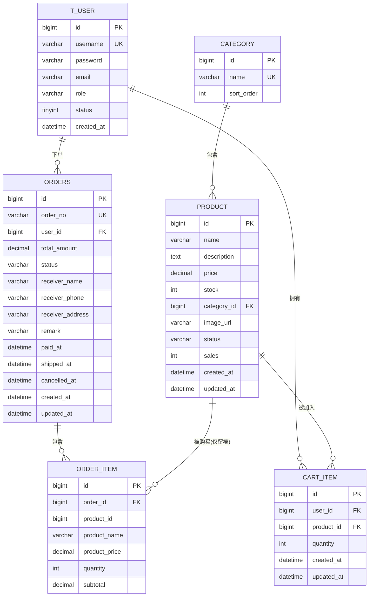

# ShopSphere 在线购物网站 · 项目计划书

> 课程：《网络应用架构设计与开发》课程实验
> 学号：______　姓名：______　班级：______　指导教师：______
> 文档版本：v1.0　编写日期：2026-10-24
> 开发周期：7 天（2026-10-24 ～ 2026-10-30）
> 技术栈：Java 21 · Spring Boot 3.2+ · Maven · Spring MVC · Thymeleaf · Bootstrap 5 · Spring Data JPA · MySQL 8 · Lombok · Validation · Session + 拦截器 · BCrypt · Docker Compose

---

## 0. 文档说明与教学模式

### 0.1 本文档的作用
1. **项目章程**：定义范围、验收标准、交付物，防止需求蔓延。
2. **执行计划**：把 7 天拆到天、拆到模块，每天有明确产出与验收动作。
3. **学习地图**：说明每天开工前必须先弄懂的概念，保证"边做边学"而不是"复制粘贴"。
4. **学术诚信依据**：规定 AI 辅助标注规范，与源码中的标注、Git 提交记录形成互相印证的三份证据。

### 0.2 教学与协作约定
| 编号 | 约定 |
|---|---|
| C1 | 先讲后写：每个新概念先用 5–10 句话说明"是什么、解决什么问题、本项目用在哪、最小示例"，再给代码 |
| C2 | 每次只推进一个小模块，单轮代码量控制在 100 行以内 |
| C3 | 每个模块结束给 3–5 道自测题，答题通过后再进入下一模块 |
| C4 | 学员说"不懂"，立即换更简单的说法，并给 20 行内可运行的最小示例，不叠加新内容 |
| C5 | 不给现成答案：必须学员手写的部分，只给字段清单、方法签名、TODO 和讲解 |
| C6 | 审查制：学员代码贴回后，从功能、异常路径、命名、AI 标注四个维度审查，缺标注不通过 |
| C7 | 每天至少 2 次 Git 提交，提交粒度为一件事 |
| C8 | 新增需求先记入 backlog，不插队；功能裁剪按第 9 章顺序执行 |

### 0.3 分工原则
学员完成 **≥60%** 的代码量，AI 只承担最难的骨架与算法部分。

| 类别 | 内容 |
|---|---|
| **学员手写** | 全部实体类字段与注解；Repository 简单查询；注册/登录/分类列表/按 ID 查商品/购物车增删改等简单 Service；登录注册/商品列表/商品详情/购物车/订单历史等简单 Controller；表单、表格循环、条件显示等简单 Thymeleaf 页面；配置类、工具类、种子 SQL、基础测试、README 手写部分 |
| **AI 辅助（完整实现 + 标注 + 讲解）** | 脚手架与 pom.xml；多条件分页查询；下单事务与价格快照；库存扣减；订单状态流转；统计报表 SQL；全局异常处理；Docker Compose 部署；复杂后台页面 |

---

## 1. 项目概述

### 1.1 项目定位
一个**可部署上线**的单体电商网站最小可行产品（MVP）。服务器端渲染，不做前后端分离；覆盖"浏览 → 加购 → 下单 → 付款 → 看订单"完整闭环，配套后台"商品管理 + 订单管理 + 简单统计"。

### 1.2 功能范围（In Scope）

**顾客端**
- 注册（用户名唯一、密码 BCrypt 加密、邮箱可选）
- 登录 / 注销（Session 会话）
- 商品列表：分类筛选 + 关键字搜索 + 分页
- 商品详情
- 购物车：加入、改数量、删除、小计与合计
- 下单：填收货信息 → 生成订单 → 清空购物车 → 扣减库存
- 模拟付款（点击即改为"已付款"，发送邮件用日志打印代替）
- 订单历史：列表 + 详情（可看到下单时的价格快照）

**管理端**
- 管理员登录（账号由种子 SQL 预置，不开放注册）
- 商品增删改查（"删除"实现为下架，即软删除）
- 订单查看、按状态筛选、发货、取消
- 简单统计表格：订单总数、销售额、热销商品 Top5

**非功能**
- 未登录访问受保护路径跳转登录页
- 普通用户访问 `/admin/**` 被拒绝
- 库存不足时下单整单回滚
- 全局异常处理 + 友好错误页

### 1.3 明确不做（Out of Scope）
| 项 | 原因 |
|---|---|
| 真实支付对接 | 需商户资质，课程实验用模拟付款 |
| 图片上传 | 需对象存储与文件服务，改用外链占位图 |
| 复杂统计图表（ECharts 等） | 用 HTML 表格替代，先保证主干 |
| 多商家 / 多店铺 | 数据模型复杂度翻倍 |
| 高并发库存（分布式锁、Redis） | 单机事务足够，超出课程范围 |
| Spring Security | 用 Session + 拦截器 + BCrypt 更易讲清原理 |
| 前后端分离（Vue/React） | 时间不够，且偏离 Thymeleaf 教学重点 |
| 真实邮件服务 | SMTP 配置与反垃圾策略耗时，用日志模拟 |
| 商品评价 / 收藏 / 优惠券 | 非核心，记入 backlog |

### 1.4 "掌握 60% 核心代码"判定清单
能**不看源码**讲清"输入 → 处理 → 输出 → 失败会怎样"即算掌握。这 10 块是答辩与报告的重点：

| # | 代码块 | 必须能回答的问题 |
|---|---|---|
| 1 | 用户注册 + BCrypt | 为什么不能存明文？盐在哪里？ |
| 2 | 登录 + Session + 拦截器 | 服务端如何"认出"已登录用户？ |
| 3 | 商品多条件分页 | 请求参数如何变成 SQL 的 WHERE / LIMIT？ |
| 4 | 购物车 upsert | 为什么同一商品只有一行？并发加购会怎样？ |
| 5 | 下单事务 | 事务边界在哪？异常时哪些表会回滚？ |
| 6 | 价格快照 | 为什么不直接关联商品现价？ |
| 7 | 库存扣减 | "条件更新"如何防止超卖？ |
| 8 | 订单状态机 | 哪些流转合法？谁有权限触发？ |
| 9 | 全局异常处理 | 业务异常和系统异常如何分流？ |
| 10 | Docker Compose | 应用如何连上容器内的 MySQL？数据为何不丢？ |

### 1.5 验收定义（Definition of Done）
一个功能算"完成"，必须同时满足：
1. 正常路径可操作，页面无 500；
2. 至少 1 条异常路径有友好提示（而非堆栈页面）；
3. 数据库数据正确（手工核对一次）；
4. 代码含完整 AI 标注；
5. 已 Git 提交，提交信息前缀合规；
6. 学员能口头讲清该功能的数据流。

---

## 2. 默认假设与风险

### 2.1 默认假设

| 项 | 默认值 |
|---|---|
| 每日投入 | 工作日 5–6 小时，周末 7–8 小时；Day1 = 2026-10-24（周六） |
| 开发环境 | Windows + JDK 21 + Maven 3.9 + MySQL 8（本机）+ Trae/IDEA + Git |
| 部署环境 | 2 核 2G Ubuntu 22.04 云服务器 + Docker Compose |
| 部署备选 | 无服务器时：本地运行 + 内网穿透（cpolar / ngrok）作为公网演示 |
| 包名 | `com.shopsphere` |
| 界面语言 | 中文，代码标识符英文 |
| 数据库 | MySQL 8，库名 `shopsphere`，字符集 utf8mb4 |
| 建表方式 | JPA `ddl-auto=update` 自动建表；种子数据由 `db/seed.sql` 或 `DataInitializer` 注入 |
| 邮件 | `log.info("已发送下单通知邮件给 {}", email)`，不接真实 SMTP |
| 支付 | "模拟付款"按钮，点击后订单状态改为 PAID |
| 权限 | 角色枚举 CUSTOMER / ADMIN；管理员账号预置 |
| 提交平台 | GitHub（或 Gitee），公开仓库 |
| 端口 | 应用 8080，MySQL 3306（容器内） |

### 2.2 风险登记表

| # | 风险 | 触发征兆 | 影响 | 应对措施 | 责任人 |
|---|---|---|---|---|---|
| R1 | 环境搭建卡住 | `mvn` 下载超时、启动报 `No compiler`、端口占用 | 直接吃掉 1–2 天 | Day1 只做"跑通空壳"；配置国内 Maven 镜像；提供逐条排错清单 | 学员 |
| R2 | 下单事务出错 | 订单生成了但明细没写、库存扣了但订单失败 | 数据不一致，答辩演示翻车 | 拆成 5 小步分别验证；先做无事务版再开 `@Transactional`；准备"库存不足"回滚演示 | 双方 |
| R3 | 部署环境不足 | 容器反复重启、`exit code 137`（OOM） | Day7 无法上线 | Day3 先用空壳镜像验证服务器；`-Xmx256m`；MySQL 调小 buffer | 学员 |
| R4 | 需求蔓延 | 想加收藏、评价、图表 | 主干做不完 | 需求冻结，写入 1.3；新增只记 backlog | 双方 |
| R5 | AI 标注缺失 | 后期清理注释、补标偷懒 | 学术诚信风险 | 标注视同代码，提交前检查；Git 前缀强制三选一；README 汇总 | 双方 |
| R6 | 能跑不能讲 | 全程复制，验收只看页面 | 达不到"讲清 60%"目标 | 每天结束 10 分钟口述录音；按 1.4 清单逐项过 | 学员 |
| R7 | Thymeleaf 模板问题 | 404 / 500 / 改了不生效 | 调试时间被吞 | 关闭模板缓存；模板名与返回值严格一致；教读异常栈顶 | 学员 |
| R8 | 服务器网络问题 | 拉镜像超时、安全组未放行端口 | 上线失败 | 配镜像加速；提前确认安全组 8080；备选内网穿透 | 学员 |

### 2.3 关于"小白一周完成"的诚实判断
- **可行条件**：每天真正动手写 3–5 小时代码 + 有逐步拆解的指导 + 每天保持一个"可运行基线"。
- **不可行条件**：以"看懂"代替"敲过"；或把 Day5（下单事务）拖到最后一天。
- **经验比例**：本项目约 20% 时间写代码，80% 时间在调试与理解数据流。这不是效率问题，是学习的必经过程。
- **保底方案**：若 Day5 结束仍无法跑通下单，则 Day6 只做"后台商品管理 + 订单列表（只读）"，放弃发货/取消分支，保证主流程与部署可用。

---

## 3. 七天执行计划

### 3.0 总览

| Day | 日期 | 主题 | 关键产出 | 验收标准 | AI 参与度 |
|---|---|---|---|---|---|
| D1 | 10-24 六 | 环境与地基 | 可运行空壳 + 3 个实体 + 建表成功 | 启动无异常，库中 3 张表结构正确 | ~45% |
| D2 | 10-25 日 | 用户与登录态 | 注册/登录/注销 + 拦截器 | 刷新保持登录；未登录访问购物车被拦截 | ~25% |
| D3 | 10-26 一 | 商品浏览 | 列表（筛选+搜索+分页）、详情、种子数据 | 翻页正确；空结果有提示；不存在商品友好 404 | ~40% |
| D4 | 10-27 二 | 购物车 | 加购/改量/删除/合计 | 重复加购合并为一行；总价计算正确 | ~20% |
| D5 | 10-28 三 | 下单闭环 | 结算→下单事务→模拟付款→订单历史 | 库存减少、购物车清空、快照单价正确 | ~45% |
| D6 | 10-29 四 | 后台管理 | 商品 CRUD、订单管理、统计表 | 越权被拒；下架商品前台不可见；统计与手算一致 | ~55% |
| D7 | 10-30 五 | 部署与交付 | 公网可访问 + README + 报告素材 | 手机流量完成一次下单；重启数据不丢 | ~50% |

### 3.1 Day 1（10-24 周六）环境与地基
**学习目标**
- 理解 Spring Boot 是什么（约定优于配置的启动器集合）
- 理解 Maven 是什么（依赖清单 + 构建工具）
- 理解三层结构：Controller 收请求、Service 放业务、Repository 管数据
- 理解 JPA 实体注解：`@Entity` `@Id` `@GeneratedValue` `@Column` `@Table`

**任务清单**
- [x] 验证环境：`java -version`（21）、`mvn -v`、MySQL 可连接
- [x] AI 生成脚手架：`pom.xml`、`application.yml`、启动类、`.gitignore`
- [x] 跑通 `GET /hello` 返回文字（**跑不通不进入下一步**）
- [x] 学员手写 `User`、`Category`、`Product` 三个实体（给字段清单 + TODO）
- [x] 启动后确认 MySQL 中 3 张表已创建
- [x] 首次 Git 提交（2 次：脚手架 / 实体）

**产出**：空壳项目 + 3 实体 + 建表成功
**验收**：① 启动日志无 ERROR ② 表结构与第 5 章一致 ③ 能各用一句话解释 4 个 JPA 注解
**AI 参与**：脚手架、pom、yml（AI 完整生成）；实体结构（AI 骨架）+ 字段含义（学员补全）

### 3.2 Day 2（10-25 周日）用户与登录态
**学习目标**：`@Controller`/`@PostMapping`、表单绑定、Service 分层、BCrypt 加盐哈希、`HttpSession`、`HandlerInterceptor` 注册与放行

**任务清单**
- [x] 注册：非空/长度校验、用户名查重、BCrypt 加密后入库
- [x] 登录：查用户 → 校验密码 → 写 Session（存 userId、username、role）
- [x] 注销：`session.invalidate()`
- [x] 拦截器：`/cart/**`、`/order/**`、`/checkout/**` 需登录
- [x] 页面：注册、登录、顶部导航（未登录显示"登录/注册"，已登录显示"你好，xxx / 注销"）
- [x] 用种子 SQL 插入 1 个管理员账号

**产出**：完整用户模块
**验收**：重复用户名有提示；错误密码有提示；刷新页面仍是登录态；未登录访问 `/cart` 跳登录页
**AI 参与**：拦截器注册骨架、页面布局片段；其余学员手写

### 3.3 Day 3（10-26 周一）商品浏览
**学习目标**：`Pageable`/`Page`/`PageRequest`、多条件查询、Thymeleaf `th:each`/`th:if`/`th:href`、URL 查询参数、空态处理

**任务清单**
- [ ] 首页商品列表：分类筛选 + 关键字（商品名模糊）+ 分页（每页 8 条）
- [ ] 商品详情页（含"加入购物车"按钮，暂只做跳转）
- [ ] 种子数据：至少 20 条商品、4 个分类
- [ ] 分页条：上一页 / 页码 / 下一页
- [ ] 不存在的商品 ID → 友好 404 页
- [ ] **部署预演**：在服务器上跑一次空壳镜像，验证端口与网络（提前排 R3）

**产出**：可浏览、可搜索、可翻页的商品前台
**验收**：第 2 页数据正确；关键字无结果有空态；`/product/9999` 不出现堆栈页
**AI 参与**：多条件分页查询方法、分页组件（AI 完整实现 + 逐行讲解）；列表页与详情页（学员手写）

### 3.4 Day 4（10-27 周二）购物车
**学习目标**：`@ManyToOne` 关联、唯一约束的作用、PRG（POST 后重定向）、"计算值不落库"的设计取舍

**任务清单**
- [ ] 加入购物车（已存在则数量 +1，依赖 `UNIQUE(user_id, product_id)`）
- [ ] 修改数量、删除单项、清空
- [ ] 购物车页：单价、数量、小计、合计（实时计算，不存库）
- [ ] 导航栏购物车角标（商品件数）
- [ ] 下架商品不可加购

**产出**：完整购物车
**验收**：同商品加两次只有一行且数量为 2；数量改为 0 视为删除；合计 = Σ(单价×数量)
**AI 参与**：仅讲解与审查，代码基本学员手写

### 3.5 Day 5（10-28 周三）下单闭环（最高风险日）
**学习目标**：事务 ACID、`@Transactional` 生效条件（同类内部调用失效、非 public 失效、默认只回滚 RuntimeException）、价格快照、订单状态机

**任务清单（严格按序，每步单独验证）**
- [ ] 步骤 1：结算页收集收货人信息（姓名/电话/地址）+ 表单校验
- [ ] 步骤 2：`OrderService.createOrder` —— 读购物车、算总价
- [ ] 步骤 3：生成订单号、写 `orders`
- [ ] 步骤 4：写 `order_item`（**存商品名与单价快照**）
- [ ] 步骤 5：条件更新扣库存（库存不足抛业务异常）
- [ ] 步骤 6：清空购物车
- [ ] 步骤 7：整方法加 `@Transactional(rollbackFor = Exception.class)`
- [ ] 步骤 8：模拟付款（CREATED → PAID）；订单列表 + 详情
- [ ] 步骤 9：故意制造库存不足，验证订单表无脏数据

**产出**：完整下单链路
**验收**：下单后库存减少、购物车清空、明细单价等于下单时价格；库存不足整单回滚；重复点击提交不产生两条订单（页面防抖或按钮禁用，可选）
**AI 参与**：事务骨架、订单号生成、条件扣库存（AI 完整实现 + 逐行讲解）；状态判断与收货校验（学员手写）

### 3.6 Day 6（10-29 周四）后台管理
**学习目标**：管理员拦截器、CRUD 表单复用、软删除、聚合查询（`GROUP BY` / `SUM` / `ORDER BY ... LIMIT`）

**任务清单**
- [ ] 管理员登录（复用登录逻辑，校验 role）
- [ ] `AdminInterceptor`：`/admin/**` 仅 ADMIN 可进
- [ ] 商品管理：列表（分页）、新增、编辑、下架/上架
- [ ] 订单管理：列表（按状态筛选）、详情、发货（PAID → SHIPPED）、取消（回补库存）
- [ ] 统计表格：订单总数、已付款订单数、总销售额、热销 Top5
- [ ] 全局异常处理：业务异常 → 提示；其他异常 → 500 页 + 日志

**产出**：`/admin/**` 全套后台
**验收**：普通用户访问 `/admin/product` 被拒；下架商品不出现在前台；统计数字与手工 SQL 一致
**AI 参与**：复杂后台页面、统计 SQL、全局异常处理（AI 完整实现 + 讲解）

### 3.7 Day 7（10-30 周五）部署与交付
**学习目标**：Dockerfile 与镜像分层、Compose 服务编排、数据卷、环境变量、端口映射、Nginx 反向代理（可选）

**任务清单**
- [ ] 编写 `Dockerfile`（多阶段构建）与 `docker-compose.yml`（app + mysql + volume）
- [ ] 服务器安装 Docker，上传代码，`docker compose up -d`
- [ ] 使用环境变量注入数据库密码，不把密码提交到仓库
- [ ] 公网访问验证（含手机 4G）
- [ ] 重启容器验证数据卷持久化
- [ ] 补 README（含 AI 辅助说明章节、测试账号）
- [ ] 整理报告素材：ER 图、截图 18 张、测试记录 ≥15 条
- [ ] 最终提交 + 打 tag `v1.0`
- [ ] 缓冲：留出 2 小时处理部署突发问题

**产出**：公网地址 + 完整仓库 + 报告素材
**验收**：外网可完整下单；重启后数据仍在；README 可按步骤复现部署
**AI 参与**：Dockerfile、compose、部署排错建议（AI 生成 + 学员执行与调整）

---

## 4. 技术栈最小知识地图

> 规则：每天开工前 30–60 分钟只学当天要用的概念，**不提前学**，避免"学完就忘"。

| Day | 学习顺序 | 达标标准（能回答） |
|---|---|---|
| D1 | JDK/环境变量 → Maven（依赖、生命周期、坐标）→ Spring Boot 启动类与自动配置 → 三层架构 → JPA 实体注解 → `ddl-auto` | "一个 HTTP 请求进来经过哪三层？""表是谁建的？" |
| D2 | `@Controller`/`@RequestMapping`/`@PostMapping` → 表单参数绑定 → Service/Repository → BCrypt → `HttpSession` → `HandlerInterceptor` | "登录一次后，后续请求服务端怎么知道是我？" |
| D3 | `Pageable`/`Page`/`PageRequest` → Thymeleaf 表达式与循环 → URL 查询参数 → 空态 | "我改了筛选条件，SQL 会怎么变？" |
| D4 | `@ManyToOne`/`@JoinColumn` → 唯一约束 → PRG → 计算列 vs 存库列 | "总价为什么每次算而不到处存？" |
| D5 | 事务 ACID → `@Transactional` 生效条件 → 回滚规则 → 快照思想 → 状态机 | "下单第 4 步失败时，前 3 步的数据会怎样？" |
| D6 | 拦截器区分角色 → CRUD 表单 → 软删除 → 聚合 SQL | "为什么删除商品实际是改状态？" |
| D7 | Dockerfile 指令 → 镜像分层与缓存 → Compose（services/volumes/environment/ports）→ 数据卷 | "容器删了为什么数据还在？" |

**每日自测题机制**：每模块结束 3–5 题，含概念题、预测题（改一行代码猜结果）、改错题（给错误代码找 bug）。答完才继续。

题型示例（Day1）：
1. `@Entity` 与 `@Table` 各管什么？不写 `@Table` 会怎样？
2. 金额为什么用 `BigDecimal` 而不是 `double`？
3. `ddl-auto=update` 下把字段改名会发生什么？生产环境为何慎用？
4. Controller 里能直接写 SQL 吗？为什么不行？

---

## 5. 数据库设计

### 5.1 实体关系（ER）



关系文字版：
```
t_user 1 ──< orders        （一个用户多张订单）
t_user 1 ──< cart_item     （一个用户多条购物车项）
orders 1 ──< order_item    （一张订单多条明细）
category 1 ──< product     （一个分类多个商品）
product 1 ──< cart_item
product 1 ──< order_item   （仅保留 product_id 留痕，不做强外键）
```

### 5.2 表结构明细

#### t_user 用户表
> 表名加 `t_` 前缀：规避 `user` 关键字歧义与 MySQL 系统库 `mysql.user` 同名，与实体 `@Table(name = "t_user")` 一致。
| 字段 | 类型 | 约束 | 说明 |
|---|---|---|---|
| id | BIGINT | PK, AUTO_INCREMENT | 主键 |
| username | VARCHAR(50) | NOT NULL, UNIQUE | 登录名 |
| password | VARCHAR(100) | NOT NULL | BCrypt 哈希（60 字符），**禁止明文** |
| email | VARCHAR(100) | NULL | 用于模拟发送邮件 |
| role | VARCHAR(20) | NOT NULL DEFAULT 'CUSTOMER' | CUSTOMER / ADMIN |
| status | TINYINT | NOT NULL DEFAULT 1 | 1 正常 0 禁用（非核心，可裁剪） |
| created_at | DATETIME | NOT NULL DEFAULT CURRENT_TIMESTAMP | 注册时间 |

#### category 分类表
| 字段 | 类型 | 约束 | 说明 |
|---|---|---|---|
| id | BIGINT | PK, AUTO_INCREMENT | |
| name | VARCHAR(50) | NOT NULL, UNIQUE | 分类名 |
| sort_order | INT | NOT NULL DEFAULT 0 | 前台展示顺序，小的在前 |

#### product 商品表
| 字段 | 类型 | 约束 | 说明 |
|---|---|---|---|
| id | BIGINT | PK, AUTO_INCREMENT | |
| name | VARCHAR(100) | NOT NULL | 商品名 |
| description | TEXT | NULL | 描述 |
| price | DECIMAL(10,2) | NOT NULL | 单价，**禁用 double** |
| stock | INT | NOT NULL DEFAULT 0 | 库存 |
| category_id | BIGINT | NOT NULL, FK→category.id | 所属分类（RESTRICT） |
| image_url | VARCHAR(255) | NULL | 外链占位图 |
| status | VARCHAR(20) | NOT NULL DEFAULT 'ON_SALE' | ON_SALE / OFF_SHELF（下架=软删除） |
| sales | INT | NOT NULL DEFAULT 0 | 累计销量（非核心，可裁剪） |
| created_at | DATETIME | NOT NULL | |
| updated_at | DATETIME | NOT NULL | |

#### cart_item 购物车项表
| 字段 | 类型 | 约束 | 说明 |
|---|---|---|---|
| id | BIGINT | PK, AUTO_INCREMENT | |
| user_id | BIGINT | NOT NULL, FK→t_user.id | |
| product_id | BIGINT | NOT NULL, FK→product.id | |
| quantity | INT | NOT NULL, CHECK (quantity > 0) | 数量 |
| created_at | DATETIME | NOT NULL | |
| updated_at | DATETIME | NOT NULL | |
| —— | —— | **UNIQUE (user_id, product_id)** | 保证一人一品一行，支撑"累加数量"逻辑 |

#### orders 订单表
> 表名用 `orders` 复数，避开 SQL 保留字 `order`。

| 字段 | 类型 | 约束 | 说明 |
|---|---|---|---|
| id | BIGINT | PK, AUTO_INCREMENT | |
| order_no | VARCHAR(32) | NOT NULL, UNIQUE | 业务单号（展示给用户） |
| user_id | BIGINT | NOT NULL, FK→t_user.id | 下单人 |
| total_amount | DECIMAL(10,2) | NOT NULL | 下单时计算并固化 |
| status | VARCHAR(20) | NOT NULL DEFAULT 'CREATED' | 见状态机 |
| receiver_name | VARCHAR(50) | NOT NULL | 收货人 |
| receiver_phone | VARCHAR(20) | NOT NULL | 联系电话 |
| receiver_address | VARCHAR(255) | NOT NULL | 收货地址 |
| remark | VARCHAR(255) | NULL | 备注（非核心，可裁剪） |
| paid_at / shipped_at / cancelled_at | DATETIME | NULL | 关键节点时间 |
| created_at | DATETIME | NOT NULL | |
| updated_at | DATETIME | NOT NULL | |

#### order_item 订单明细表（价格快照）
| 字段 | 类型 | 约束 | 说明 |
|---|---|---|---|
| id | BIGINT | PK, AUTO_INCREMENT | |
| order_id | BIGINT | NOT NULL, FK→orders.id | |
| product_id | BIGINT | NOT NULL | 仅留痕，不做强外键 |
| product_name | VARCHAR(100) | NOT NULL | **快照**：下单时商品名 |
| product_price | DECIMAL(10,2) | NOT NULL | **快照**：下单时单价 |
| quantity | INT | NOT NULL | |
| subtotal | DECIMAL(10,2) | NOT NULL | 单价×数量，便于统计 |

#### order_status_log 订单状态日志（可选，第一个裁剪）
| 字段 | 类型 | 说明 |
|---|---|---|
| id | BIGINT PK | |
| order_id | BIGINT FK | |
| from_status / to_status | VARCHAR(20) | 流转前后状态 |
| operator | VARCHAR(50) | 操作人 |
| created_at | DATETIME | |

### 5.3 订单状态机

```
CREATED(待付款) ──模拟付款──> PAID(已付款) ──管理员发货──> SHIPPED(已发货) ──确认收货──> COMPLETED(已完成)
      │                          │
      └──用户/管理员取消──> CANCELLED(已取消) ←──管理员取消(回补库存)──┘
```

规则：
- 只有 `CREATED` 和 `PAID` 可取消；`SHIPPED` 之后不可取消。
- 取消 `PAID` 订单需回补库存。
- 前台用户只能操作自己的订单（用 `user_id` 过滤，防止越权）。

### 5.4 索引设计

| 表 | 索引名 | 字段 | 理由 |
|---|---|---|---|
| t_user | `uk_user_username` | (username) UNIQUE | 登录查询 + 注册查重 |
| orders | `uk_order_no` | (order_no) UNIQUE | 单号唯一、详情查询 |
| orders | `idx_order_user_created` | (user_id, created_at) | "我的订单"按时间倒序 |
| orders | `idx_order_status_created` | (status, created_at) | 后台按状态筛选 |
| cart_item | `uk_cart_user_product` | (user_id, product_id) UNIQUE | 加购 upsert + 唯一性 |
| product | `idx_product_category_status` | (category_id, status) | 前台按分类只看在售 |
| product | `idx_product_name` | (name) | 关键字查询（`LIKE '%x%'` 实际用不上，MVP 可接受） |
| order_item | `idx_order_item_order` | (order_id) | 订单详情取明细 |

原则：索引是"书的目录"，加速按列查找，但每次写入都要维护，**MVP 阶段 8 个索引足够，不堆砌**。

### 5.5 参考 DDL（仅设计参考，实际由 JPA `ddl-auto=update` 生成）

```sql
-- ============================================================
-- AI 辅助说明：本文件由 AI 辅助生成/修改
-- 生成内容：基于设计文档生成的参考建表语句
-- 人工修改：索引命名与字段注释由本人核对
-- 审查状态：待人工审查
-- ============================================================

CREATE DATABASE IF NOT EXISTS shopsphere
  DEFAULT CHARACTER SET utf8mb4 COLLATE utf8mb4_general_ci;

-- [手写] 用户表（t_user：规避 user 关键字/系统库同名，与实体 @Table 一致）
CREATE TABLE t_user (
  id          BIGINT       NOT NULL AUTO_INCREMENT,
  username    VARCHAR(50)  NOT NULL,
  password    VARCHAR(100) NOT NULL,
  email       VARCHAR(100) NULL,
  role        VARCHAR(20)  NOT NULL DEFAULT 'CUSTOMER',
  status      TINYINT      NOT NULL DEFAULT 1,
  created_at  DATETIME     NOT NULL DEFAULT CURRENT_TIMESTAMP,
  PRIMARY KEY (id),
  UNIQUE KEY uk_user_username (username)
) ENGINE=InnoDB DEFAULT CHARSET=utf8mb4;

-- [手写] 分类表
CREATE TABLE category (
  id         BIGINT      NOT NULL AUTO_INCREMENT,
  name       VARCHAR(50) NOT NULL,
  sort_order INT         NOT NULL DEFAULT 0,
  PRIMARY KEY (id),
  UNIQUE KEY uk_category_name (name)
) ENGINE=InnoDB DEFAULT CHARSET=utf8mb4;

-- [手写] 商品表
CREATE TABLE product (
  id          BIGINT        NOT NULL AUTO_INCREMENT,
  name        VARCHAR(100)  NOT NULL,
  description TEXT          NULL,
  price       DECIMAL(10,2) NOT NULL,
  stock       INT           NOT NULL DEFAULT 0,
  category_id BIGINT        NOT NULL,
  image_url   VARCHAR(255)  NULL,
  status      VARCHAR(20)   NOT NULL DEFAULT 'ON_SALE',
  sales       INT           NOT NULL DEFAULT 0,
  created_at  DATETIME      NOT NULL DEFAULT CURRENT_TIMESTAMP,
  updated_at  DATETIME      NOT NULL DEFAULT CURRENT_TIMESTAMP ON UPDATE CURRENT_TIMESTAMP,
  PRIMARY KEY (id),
  KEY idx_product_category_status (category_id, status),
  KEY idx_product_name (name),
  CONSTRAINT fk_product_category FOREIGN KEY (category_id) REFERENCES category (id)
) ENGINE=InnoDB DEFAULT CHARSET=utf8mb4;

-- [手写] 购物车表
CREATE TABLE cart_item (
  id         BIGINT   NOT NULL AUTO_INCREMENT,
  user_id    BIGINT   NOT NULL,
  product_id BIGINT   NOT NULL,
  quantity   INT      NOT NULL,
  created_at DATETIME NOT NULL DEFAULT CURRENT_TIMESTAMP,
  updated_at DATETIME NOT NULL DEFAULT CURRENT_TIMESTAMP ON UPDATE CURRENT_TIMESTAMP,
  PRIMARY KEY (id),
  UNIQUE KEY uk_cart_user_product (user_id, product_id),  -- 支撑"同品累加"
  CONSTRAINT fk_cart_user    FOREIGN KEY (user_id)    REFERENCES t_user (id),
  CONSTRAINT fk_cart_product FOREIGN KEY (product_id) REFERENCES product (id)
) ENGINE=InnoDB DEFAULT CHARSET=utf8mb4;

-- [手写] 订单表（orders 避开保留字 order）
CREATE TABLE orders (
  id               BIGINT        NOT NULL AUTO_INCREMENT,
  order_no         VARCHAR(32)   NOT NULL,
  user_id          BIGINT        NOT NULL,
  total_amount     DECIMAL(10,2) NOT NULL,
  status           VARCHAR(20)   NOT NULL DEFAULT 'CREATED',
  receiver_name    VARCHAR(50)   NOT NULL,
  receiver_phone   VARCHAR(20)   NOT NULL,
  receiver_address VARCHAR(255)  NOT NULL,
  remark           VARCHAR(255)  NULL,
  paid_at          DATETIME      NULL,
  shipped_at       DATETIME      NULL,
  cancelled_at     DATETIME      NULL,
  created_at       DATETIME      NOT NULL DEFAULT CURRENT_TIMESTAMP,
  updated_at       DATETIME      NOT NULL DEFAULT CURRENT_TIMESTAMP ON UPDATE CURRENT_TIMESTAMP,
  PRIMARY KEY (id),
  UNIQUE KEY uk_order_no (order_no),
  KEY idx_order_user_created (user_id, created_at),
  KEY idx_order_status_created (status, created_at),
  CONSTRAINT fk_order_user FOREIGN KEY (user_id) REFERENCES t_user (id)
) ENGINE=InnoDB DEFAULT CHARSET=utf8mb4;

-- [手写] 订单明细表（价格快照）
CREATE TABLE order_item (
  id            BIGINT        NOT NULL AUTO_INCREMENT,
  order_id      BIGINT        NOT NULL,
  product_id    BIGINT        NOT NULL,
  product_name  VARCHAR(100)  NOT NULL,   -- 快照：商品名
  product_price DECIMAL(10,2) NOT NULL,   -- 快照：下单单价
  quantity      INT           NOT NULL,
  subtotal      DECIMAL(10,2) NOT NULL,
  PRIMARY KEY (id),
  KEY idx_order_item_order (order_id),
  CONSTRAINT fk_item_order FOREIGN KEY (order_id) REFERENCES orders (id)
) ENGINE=InnoDB DEFAULT CHARSET=utf8mb4;
```

---

## 6. 包结构

```
ShopSphere/
├── pom.xml
├── Dockerfile
├── docker-compose.yml
├── .gitignore
├── README.md                        # 含"AI 辅助说明"章节
├── docs/                            # 本计划书、ER 图、截图、测试记录
│   ├── 项目计划书.md
│   ├── er-diagram.png
│   ├── test-record.md
│   └── screenshots/
└── src/main/
    ├── java/com/shopsphere/
    │   ├── ShopSphereApplication.java        # 启动类
    │   ├── config/                           # WebConfig（拦截器注册）、DataInitializer（种子数据）
    │   ├── interceptor/                      # LoginInterceptor、AdminInterceptor
    │   ├── entity/                           # User、Category、Product、CartItem、Order、OrderItem
    │   ├── repository/                       # 各实体的 Repository 接口
    │   ├── service/                          # UserService、ProductService、CartService、OrderService、StatsService
    │   ├── controller/
    │   │   ├── shop/                         # AuthController、ProductController、CartController、OrderController
    │   │   └── admin/                        # AdminAuthController、AdminProductController、AdminOrderController、AdminStatsController
    │   ├── form/                             # RegisterForm、LoginForm、CheckoutForm、ProductForm
    │   ├── exception/                        # BusinessException、GlobalExceptionHandler
    │   ├── common/                           # OrderStatus、Role 枚举，OrderNoGenerator
    │   └── dto/                              # CartView、OrderDetailView（可选）
    └── resources/
        ├── application.yml
        ├── application-docker.yml
        ├── db/seed.sql                       # 20 商品 + 4 分类 + 1 管理员
        ├── templates/
        │   ├── fragments/                    # layout.html、nav.html
        │   ├── auth/                         # login.html、register.html
        │   ├── product/                      # list.html、detail.html
        │   ├── cart/                         # list.html、checkout.html
        │   ├── order/                        # list.html、detail.html
        │   ├── admin/                        # login.html、product-list.html、product-form.html、order-list.html、stats.html
        │   └── error/                        # 404.html、500.html
        └── static/css/style.css
```

**设计取舍说明**
1. **Service 不写 interface + impl**：MVP 只有单一实现，接口是额外负担。当出现多实现（如多种支付渠道）或需要跨层替换时才引入接口。
2. **`dto` 与 `form` 分离**：`form` 承接页面输入并做校验，`dto` 是页面展示的组装对象，避免把实体直接扔给模板导致懒加载异常。
3. **枚举集中放 `common`**：`OrderStatus`、`Role` 被 Service 与模板共用，集中定义避免字符串硬编码。

---

## 7. AI 辅助标注规范（强制）

### 7.1 文件顶部标注（Java）
```java
// ============================================================
// AI 辅助说明：本文件由 AI 辅助生成/修改
// 生成内容：<哪些部分由 AI 生成>
// 人工修改：<我修改或手写了哪些部分>
// 审查状态：待人工审查 / 已人工审查并修改
// ============================================================
```

### 7.2 方法级标注（四选一，必须出现）
| 标记 | 含义 |
|---|---|
| `// [AI辅助] 该方法由 AI 生成，已由本人审查` | AI 完整生成，本人确认理解 |
| `// [AI骨架] 方法签名和结构由 AI 提供，方法体由本人实现` | 结构 AI、逻辑本人 |
| `// [手写] 本人独立完成` | 完全本人 |
| `// [AI片段] 此段逻辑参考 AI 建议，已由本人整合修改` | 局部参考 |

### 7.3 其他文件类型标注语法
| 文件类型 | 注释语法 | 示例 |
|---|---|---|
| Thymeleaf / HTML | `<!-- ... -->` | `<!-- AI辅助：页面骨架由 AI 生成 -->` |
| SQL | `-- ` | `-- [AI辅助] 统计查询由 AI 生成` |
| YAML / Dockerfile | `# ` | `# [手写] 端口映射` |
| properties | `# ` | 同 YAML |
| README | Markdown 引用块 | `> AI 辅助说明：本节由 AI 起草，本人核对` |

### 7.4 标注纪律（红线）
1. **禁止删除标注**，包括重构、格式化、清理注释时。
2. **禁止把 AI 生成说成手写**；不确定来源时按"AI辅助"标注（保守原则）。
3. 审查状态只有两个合法值：`待人工审查` / `已人工审查并修改`。未经本人阅读不得写"已审查"。
4. 每次提交前搜索核对：`AI辅助`、`AI骨架`、`手写`、`AI片段` 是否覆盖本次改动。

### 7.5 Git 提交信息规范
格式：`<类型前缀>：<做了什么>`

| 前缀 | 使用场景 |
|---|---|
| `手写：` | 本次提交主体为本人编写 |
| `AI骨架：` | AI 提供结构、本人实现方法体 |
| `AI辅助：` | AI 生成主要内容、本人审查修改 |

示例：
```
AI辅助：搭建 Spring Boot 脚手架与 pom 依赖
手写：User/Category/Product 实体字段与注解
AI骨架：CartController 路由与方法签名
手写：注册表单页面与字段校验提示
手写：修复购物车数量累加时同一商品重复插入
```
要求：一次提交只做一件事；混合内容在正文说明比例。

### 7.6 README「AI 辅助说明」章节模板
```markdown
## AI 辅助说明

### AI 参与范围
| 模块 | AI 参与方式 | 说明 |
|---|---|---|
| 项目脚手架 / pom.xml | AI辅助 | AI 生成，本人核对依赖版本 |
| 多条件分页查询 | AI辅助 | AI 生成 Specification，本人调试参数 |
| 下单事务与价格快照 | AI辅助 | AI 生成事务骨架，本人补充校验 |
| 统计报表 SQL | AI辅助 | AI 生成，本人核对口径 |
| Docker 部署 | AI辅助 | AI 生成 compose，本人在服务器执行排错 |

### 本人独立完成
- 全部实体类字段与 JPA 注解
- 注册/登录/注销、购物车、商品列表与详情
- 全部前台 Thymeleaf 页面
- 种子 SQL、README、测试记录

### 标注约定
源码中所有 AI 参与部分均带有文件级与方法级标注，可通过 `AI辅助`、`AI骨架`、`[手写]` 关键字检索。
```

---

## 8. 最终交付物与报告素材

### 8.1 交付物清单
| # | 交付物 | 内容要求 | 状态 |
|---|---|---|---|
| 1 | 源码仓库 | GitHub/Gitee 公开；含 `.gitignore`；不含 `target/`、不含真实密码 | ☐ |
| 2 | 公网地址 | `http://<IP>:8080`，可完成完整下单 | ☐ |
| 3 | 测试账号 | 顾客 2 个（其一有历史订单）、管理员 1 个 | ☐ |
| 4 | README.md | 项目简介 / 技术栈 / 本地运行 / 部署说明 / 功能与不做清单 / AI 辅助说明 / 学号姓名 | ☐ |
| 5 | 报告素材 | 设计思路、ER 图、核心代码（带标注）、截图、测试记录、学习总结 | ☐ |
| 6 | `docs/test-record.md` | ≥15 条用例：编号 / 步骤 / 预期 / 实际 / 结论 | ☐ |

### 8.2 截图清单（建议存入 `docs/screenshots/`）

| # | 文件名 | 内容 | 用途 |
|---|---|---|---|
| 1 | `01-home.png` | 首页商品列表（含分页） | 功能展示 |
| 2 | `02-search.png` | 关键字搜索结果 | 功能展示 |
| 3 | `03-product-detail.png` | 商品详情页 | 功能展示 |
| 4 | `04-register.png` | 注册页（含校验报错） | 测试记录 |
| 5 | `05-login.png` | 登录页 | 功能展示 |
| 6 | `06-cart.png` | 购物车（2 种商品，小计与合计） | 功能展示 |
| 7 | `07-checkout.png` | 结算页（收货信息） | 功能展示 |
| 8 | `08-pay-success.png` | 模拟支付成功页 | 功能展示 |
| 9 | `09-order-list.png` | 我的订单列表（多状态） | 功能展示 |
| 10 | `10-order-detail.png` | 订单详情（可见价格快照） | **核心亮点** |
| 11 | `11-admin-product.png` | 后台商品管理 | 功能展示 |
| 12 | `12-admin-order.png` | 后台订单管理（发货操作） | 功能展示 |
| 13 | `13-admin-stats.png` | 统计表格 | 功能展示 |
| 14 | `14-db-tables.png` | 数据库表结构（Workbench/Navicat） | 报告 |
| 15 | `15-docker-ps.png` | 服务器 `docker compose ps` 运行中 | 部署证明 |
| 16 | `16-public-access.png` | 手机 4G 访问公网地址 | 部署证明 |
| 17 | `17-ai-annotation.png` | 代码顶部 AI 标注特写 | **学术诚信证明** |
| 18 | `18-git-log.png` | Git 提交记录（前缀规范） | 报告 |

### 8.3 测试记录必覆盖场景
| # | 用例 | 预期 |
|---|---|---|
| 1 | 重复用户名注册 | 提示"用户名已存在"，不写库 |
| 2 | 登录密码错误 | 提示"用户名或密码错误" |
| 3 | 未登录访问 `/cart` | 302 跳转登录页 |
| 4 | 普通用户访问 `/admin/product` | 拒绝访问 |
| 5 | 同一商品加购两次 | 一行记录，数量为 2 |
| 6 | 库存不足商品下单 | 提示库存不足，订单表无记录 |
| 7 | 下单成功后检查库存与购物车 | 库存减少，购物车清空 |
| 8 | 后台修改商品价格后查看历史订单 | 历史订单单价不变（快照生效） |
| 9 | 下架商品后在首页搜索 | 前台不可见 |
| 10 | 订单从 PAID 发货为 SHIPPED | 状态更新，`shipped_at` 有值 |
| 11 | SHIPPED 订单尝试取消 | 被拒绝 |
| 12 | 访问不存在商品 `/product/9999` | 友好 404 页 |
| 13 | 重启应用 | 数据仍存在 |
| 14 | 重启容器（部署后） | 数据卷生效，数据不丢 |
| 15 | 手机 4G 访问公网地址 | 可完整下单 |

### 8.4 报告结构建议
1. 需求分析（用户角色、功能清单、不做清单）
2. 系统设计（架构图、包结构、ER 图、状态机）
3. 数据库设计（表结构、索引、设计取舍）
4. 核心实现（选 5 段代码 + 标注截图，对应 1.4 清单）
5. 部署说明（Dockerfile / compose 关键行解释、踩坑记录）
6. 测试记录（表格）
7. 学习总结（新学概念清单、遇到的 3 个最大问题及解决过程、AI 使用反思）
8. 附录（AI 辅助清单、Git 提交统计）

---

## 9. 功能裁剪与应急方案

### 9.1 裁剪顺序（从先到后）
1. 复杂统计图表（改纯 HTML 表格）
2. 图片上传（本就不做）
3. Nginx 反向代理（直接暴露 8080）
4. 真实邮件（改日志）
5. 非核心字段：备注 remark、销量 sales、用户 status、订单状态日志表
6. 订单取消/恢复库存分支（保留发货）

**永不裁剪**：主流程（注册→浏览→加购→下单→付款）、订单历史、商品管理、订单管理、部署上线。

### 9.2 进度落后应急方案
| 落后程度 | 措施 |
|---|---|
| 落后半天 | 当天手写部分改为"AI 骨架 + 学员补方法体"，标注相应调整 |
| 落后 1 天 | 启用 9.1 裁剪第 3–4 项；后台只做商品管理 + 订单只读 |
| 落后 2 天 | 后台合并为单页 Tabs；统计只做 3 个数字；部署改内网穿透 |
| 始终不达标 | 保证"可演示 + 可讲清 10 个核心块"优先于"功能完整" |

---

## 10. 待确认信息

| 项 | 默认值 | 需你确认 |
|---|---|---|
| 学号 / 姓名 / 班级 | 占位符 | ☐ |
| 是否有云服务器（配置 / 系统） | 2C2G Ubuntu 22.04 | ☐ |
| 老师是否强制 Docker | 不强制，做了加分 | ☐ |
| 报告模板 / 字数 / 是否要求 ER 图 | 需要 ER 图 + 截图 + 测试记录 | ☐ |
| 界面是否需要英文 | 纯中文 | ☐ |
| 提交平台 | GitHub | ☐ |
| 本机 MySQL 是否已装、root 密码 | 已装，密码已知 | ☐ |
| 每日实际可投入时段 | 19:00–24:00 | ☐ |

> 未确认项一律按默认值执行，后续可调整，不影响 Day1 开工。

---

## 附录 A：每日结束输出模板

```markdown
### Day X 收尾
- 完成项：
- 未完成项及原因：
- 今日应掌握知识点（3–5 条）：
- 自测题（3–5 道，含答案要点）：
- Git 提交建议：
- AI 参与清单（本日）：
- 明日任务与前置准备：
```

## 附录 B：每日自测题模板（题型配比）

| 题型 | 数量 | 目的 |
|---|---|---|
| 概念题（"什么是 X，解决什么问题"） | 1–2 | 检验理解而非记忆 |
| 预测题（改一行代码，猜结果） | 1–2 | 检验是否真的理解数据流 |
| 改错题（给错误代码找 bug） | 1 | 检验调试能力 |
| 迁移题（换个场景还用得上吗） | 1 | 检验知识迁移 |

---

*本计划书为项目执行基准，变更需记录版本。*
